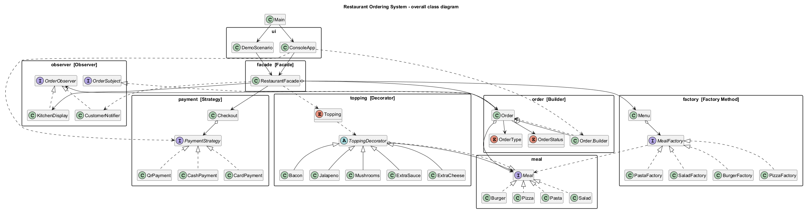

# Restaurant Ordering System

Final project for the Software Design Patterns course: a console restaurant
ordering system in Java that combines six design patterns.

Staff can create orders from the menu, add extra toppings, move orders through the
kitchen workflow, and take payment in cash, by card or by QR code. The kitchen and
the customer are notified on every status change.

## Team

| Member | Patterns |
|---|---|
| Zhassyn Zhalynuly ([zzhassyn](https://github.com/zzhassyn)) | Factory Method, Decorator, Builder |
| Daniyar Baikanov ([Daniyaar07](https://github.com/Daniyaar07)) | Observer, Strategy, Facade |

## Design patterns

| Pattern | Where | What it does here |
|---|---|---|
| Factory Method | `factory/MealFactory`, `factory/Menu` | Each dish (`Burger`, `Pizza`, `Pasta`, `Salad`) is created by its own factory, chosen by menu number |
| Decorator | `topping/ToppingDecorator` | Toppings (`ExtraCheese`, `Bacon`, ...) wrap any meal at runtime and add to its description and price |
| Builder | `order/Order.Builder` | Assembles an order step by step and rejects invalid combinations, such as dine-in without a table |
| Observer | `observer/*`, `order/Order` | `KitchenDisplay` and `CustomerNotifier` are notified on every order status change |
| Strategy | `payment/*` | `CashPayment`, `CardPayment` and `QrPayment` are interchangeable through the `Checkout` context |
| Facade | `facade/RestaurantFacade` | One entry point for the whole workflow; an order can be completed only after it is paid |

## Project structure

```
src/com/restaurant/
  Main.java            entry point
  meal/                Meal interface and dishes
  factory/             meal factories and the menu
  topping/             topping decorators
  order/               Order, Order.Builder, OrderType, OrderStatus
  observer/            subject/observer interfaces, kitchen and customer observers
  payment/             payment strategies and the checkout context
  facade/              RestaurantFacade
  ui/                  console app and demo scenario
docs/
  REPORT.md            project report draft
  demo-output.txt      output of the demo scenario
  uml/                 PlantUML sources and rendered PNG diagrams
```

## Requirements

- JDK 17 or newer

## Run

Windows:

```
run.bat            # interactive console
run.bat --demo     # scripted demo of all six patterns
```

Linux / macOS:

```
./run.sh
./run.sh --demo
```

Manual build:

```
javac --release 17 -d out -sourcepath src src/com/restaurant/Main.java
java -cp out com.restaurant.Main
```

## UML diagrams

Rendered diagrams are in [`docs/uml`](docs/uml). To regenerate them from the `.puml`
sources:

```
java -jar plantuml.jar -tpng docs/uml/*.puml
```


