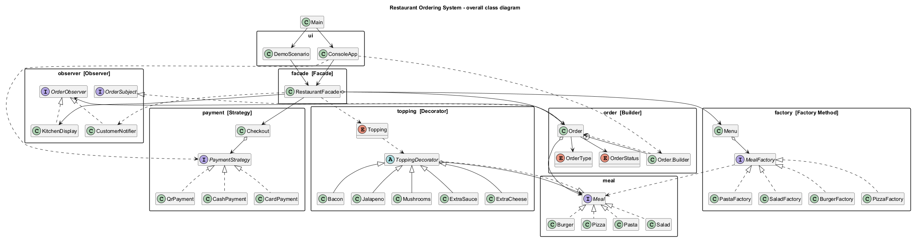
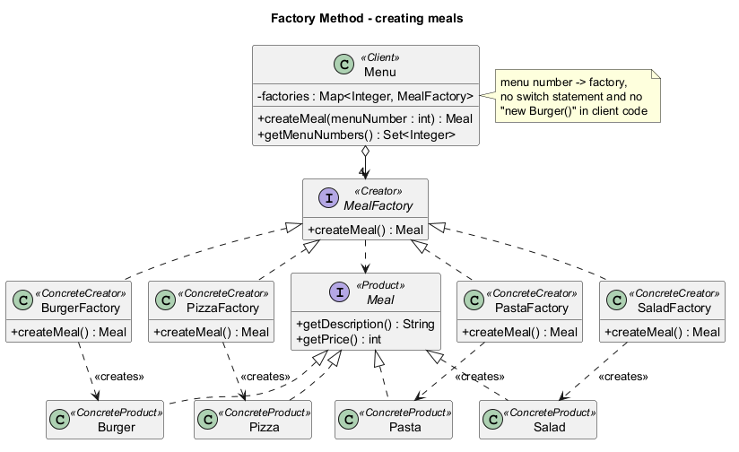
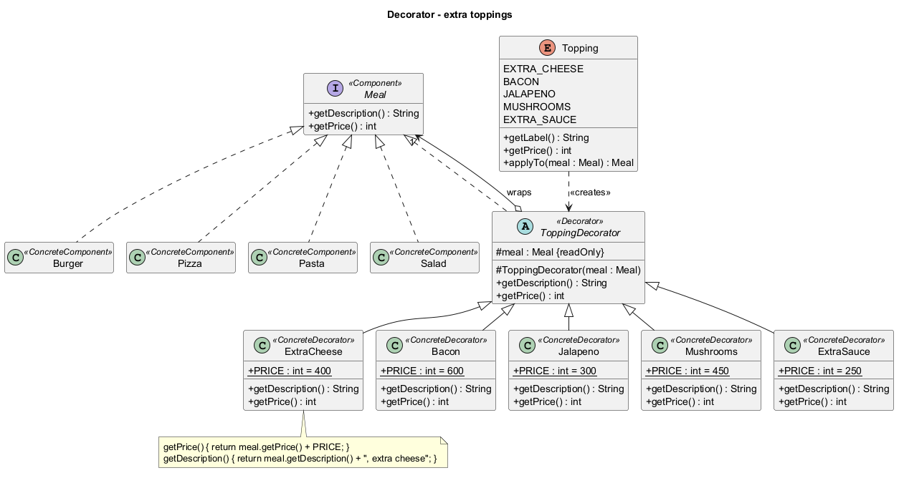
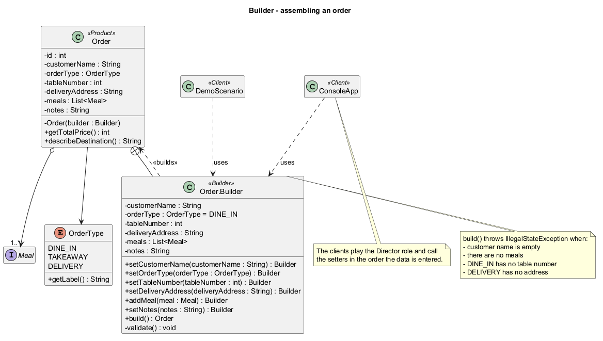
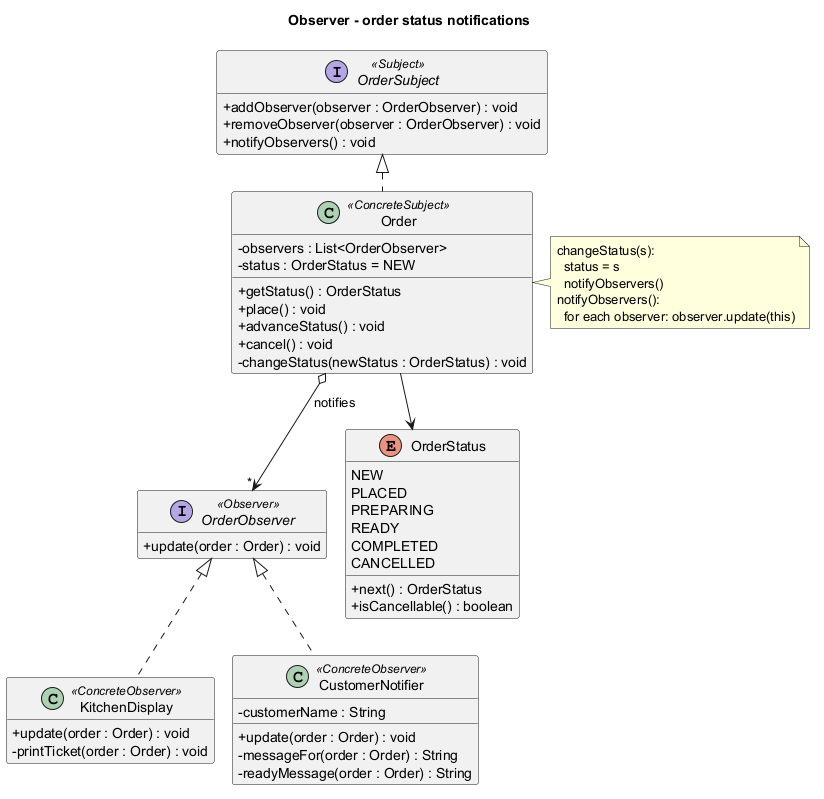
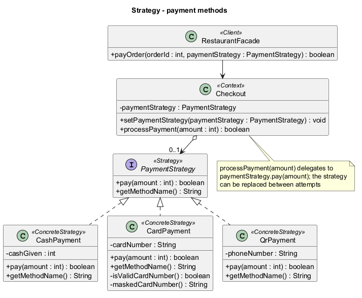
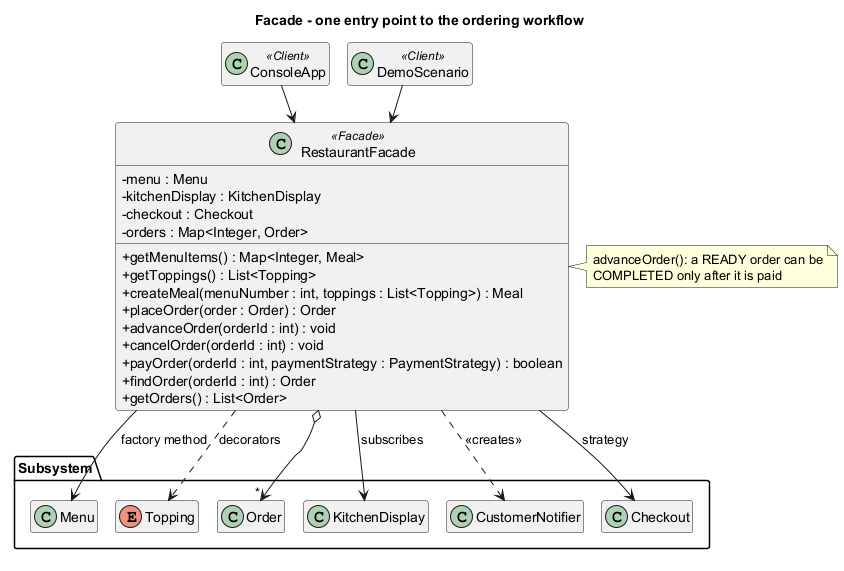
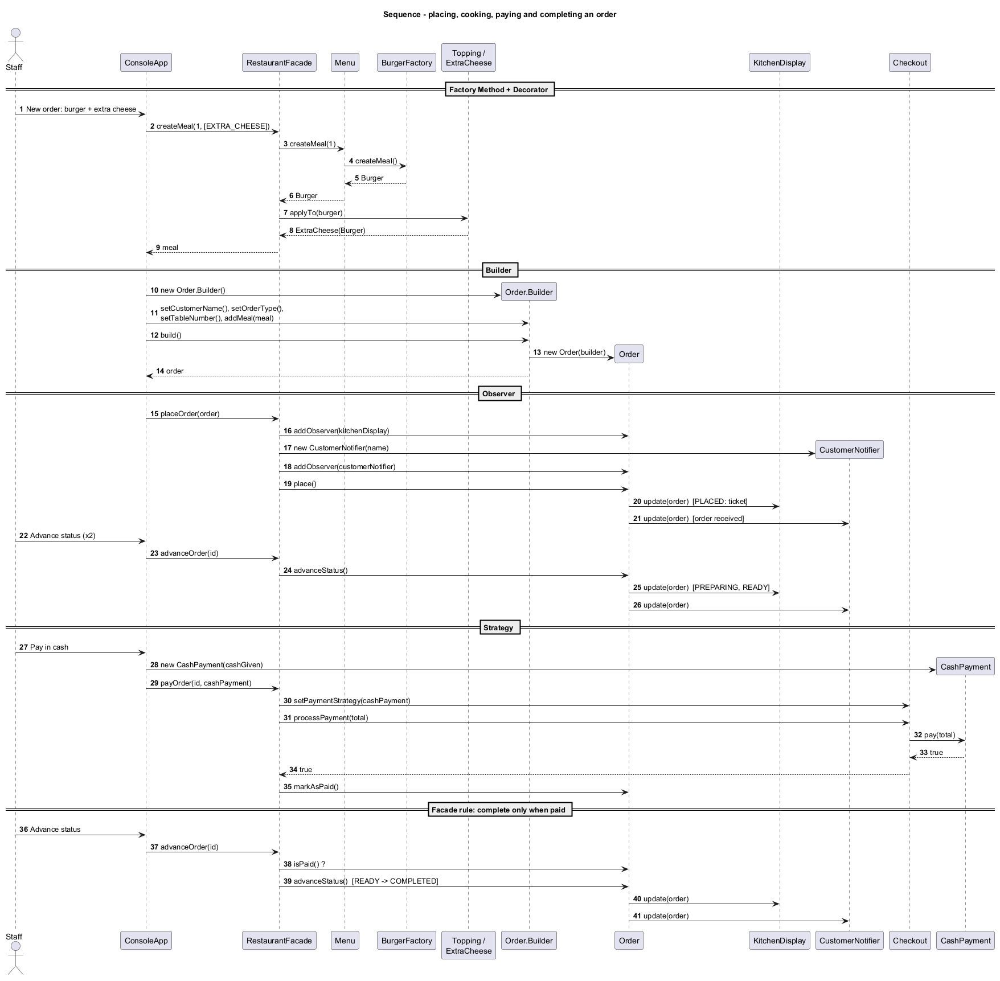

# Restaurant Ordering System

**Final Project Report — Software Design Patterns**

| | |
|---|---|
| Team | Zhassyn Zhalynuly, Daniyar Baikanov |
| Group | _to be filled in_ |
| Lecturer | Almas Ospanov |
| Language | Java 17 |
| Repository | https://github.com/zzhassyn/restaurant-ordering-system |

---

## Contents

1. [Introduction](#1-introduction)
2. [Body](#2-body)
   - 2.1 [Architecture overview](#21-architecture-overview)
   - 2.2 [Factory Method](#22-factory-method--creating-meals)
   - 2.3 [Decorator](#23-decorator--extra-toppings)
   - 2.4 [Builder](#24-builder--assembling-an-order)
   - 2.5 [Observer](#25-observer--order-status-notifications)
   - 2.6 [Strategy](#26-strategy--payment-methods)
   - 2.7 [Facade](#27-facade--one-entry-point)
   - 2.8 [How the patterns work together](#28-how-the-patterns-work-together)
   - 2.9 [Application screenshots](#29-application-screenshots)
   - 2.10 [Clean Code principles applied](#210-clean-code-principles-applied)
3. [Conclusion](#3-conclusion)
4. [Further work](#4-further-work)
5. [References](#5-references)

---

## 1. Introduction

### 1.1 Problem statement

A restaurant takes orders for different dishes. Customers often want to change a
dish, for example by adding extra cheese or bacon. An order can be eaten in, taken
away or delivered, and each type needs different details. Once an order is placed,
the kitchen has to know what to cook and the customer wants to know when the food
is ready. Finally, the customer pays in cash, by card or by QR code.

If all of this is written as one big class with `if`/`switch` statements, every new
dish, topping, notification or payment method means changing existing code. The
goal of this project is to show how design patterns from the course keep each of
these concerns separate and open for extension.

### 1.2 Goals

- Build a working console application for taking and processing restaurant orders.
- Implement **six design patterns** from the course in one cohesive project:
  Factory Method, Decorator, Builder, Observer, Strategy and Facade.
- Make the patterns cooperate: a meal created by a factory is wrapped by
  decorators, put into an order by a builder, tracked by observers, paid through a
  strategy, and the whole flow is coordinated by a facade.
- Document the design with UML class and sequence diagrams.

### 1.3 Technologies

- **Java 17** (no external libraries, no build tool required)
- **PlantUML** for UML diagrams
- **Git / GitHub** for version control and teamwork

### 1.4 Team and division of work

Each team member implemented three patterns.

| Member | Patterns | Packages |
|---|---|---|
| Zhassyn Zhalynuly | Factory Method, Decorator, Builder | `meal`, `factory`, `topping`, `order` (builder) |
| Daniyar Baikanov | Observer, Strategy, Facade | `observer`, `order` (status), `payment`, `facade`, `ui` |

---

## 2. Body

### 2.1 Architecture overview

The source code lives in `src/com/restaurant`, with one package per responsibility:

| Package | Contents | Pattern |
|---|---|---|
| `meal` | `Meal` interface and the dishes `Burger`, `Pizza`, `Pasta`, `Salad` | Factory Method (products), Decorator (component) |
| `factory` | `MealFactory`, one factory per dish, `Menu` | Factory Method |
| `topping` | `ToppingDecorator`, five toppings, `Topping` enum | Decorator |
| `order` | `Order` with nested `Order.Builder`, `OrderType`, `OrderStatus` | Builder, Observer (subject) |
| `observer` | `OrderSubject`, `OrderObserver`, `KitchenDisplay`, `CustomerNotifier` | Observer |
| `payment` | `PaymentStrategy`, `CashPayment`, `CardPayment`, `QrPayment`, `Checkout` | Strategy |
| `facade` | `RestaurantFacade` | Facade |
| `ui` | `ConsoleApp`, `DemoScenario` | Client |



*Figure 1. Overall class diagram.*

---

### 2.2 Factory Method — creating meals

*Implemented by Zhassyn Zhalynuly.*

**Intent.** Define an interface for creating an object, but let subclasses decide
which class to instantiate.

**Problem.** The application must create different dishes without the ordering code
calling `new Burger()` or `new Pizza()` and without a `switch` over dish names.
Adding a dish must not change the code that orders it.

**Solution.** `Meal` is the product interface. Every dish has its own factory that
implements `MealFactory.createMeal()`. `Menu` keeps a map from menu number to
factory, so a dish is created by number and the client only sees the `Meal`
interface.

| Role (Lecture 2) | Class |
|---|---|
| Product | `Meal` |
| Concrete Product | `Burger`, `Pizza`, `Pasta`, `Salad` |
| Creator | `MealFactory` |
| Concrete Creator | `BurgerFactory`, `PizzaFactory`, `PastaFactory`, `SaladFactory` |
| Client | `Menu` (used by `RestaurantFacade`) |

```java
public interface MealFactory {

    Meal createMeal();
}

public class BurgerFactory implements MealFactory {

    @Override
    public Meal createMeal() {
        return new Burger();
    }
}

public class Menu {

    private final Map<Integer, MealFactory> factories = new LinkedHashMap<>();

    public Menu() {
        factories.put(1, new BurgerFactory());
        factories.put(2, new PizzaFactory());
        factories.put(3, new PastaFactory());
        factories.put(4, new SaladFactory());
    }

    public Meal createMeal(int menuNumber) {
        MealFactory factory = factories.get(menuNumber);
        if (factory == null) {
            throw new IllegalArgumentException("There is no dish with menu number " + menuNumber);
        }
        return factory.createMeal();
    }
}
```



*Figure 2. Factory Method.*

**Result.** Adding a new dish (for example soup) means adding a `Soup` class, a
`SoupFactory` and one line in `Menu`. No other class changes, which follows the
Open/Closed Principle.

---

### 2.3 Decorator — extra toppings

*Implemented by Zhassyn Zhalynuly.*

**Intent.** Attach additional responsibilities to an object dynamically. Decorators
are a flexible alternative to subclassing for extending behaviour.

**Problem.** Any dish can get any number of toppings, in any combination. Creating
a subclass for every combination (`BurgerWithCheese`, `BurgerWithCheeseAndBacon`,
...) would cause a class explosion.

**Solution.** `ToppingDecorator` implements `Meal` and also holds a `Meal`. Each
concrete topping adds its own text to the description and its price to the total,
then delegates to the wrapped meal. Because a decorator is a `Meal`, it can be
wrapped again, so toppings stack at runtime. The `Topping` enum maps each choice
in the user interface to its decorator.

| Role (Lecture 5) | Class |
|---|---|
| Component | `Meal` |
| Concrete Component | `Burger`, `Pizza`, `Pasta`, `Salad` |
| Decorator | `ToppingDecorator` |
| Concrete Decorator | `ExtraCheese`, `Bacon`, `Jalapeno`, `Mushrooms`, `ExtraSauce` |

```java
public abstract class ToppingDecorator implements Meal {

    protected final Meal meal;

    protected ToppingDecorator(Meal meal) {
        this.meal = meal;
    }

    @Override
    public String getDescription() {
        return meal.getDescription();
    }

    @Override
    public int getPrice() {
        return meal.getPrice();
    }
}

public class ExtraCheese extends ToppingDecorator {

    public static final int PRICE = 400;

    public ExtraCheese(Meal meal) {
        super(meal);
    }

    @Override
    public String getDescription() {
        return meal.getDescription() + ", extra cheese";
    }

    @Override
    public int getPrice() {
        return meal.getPrice() + PRICE;
    }
}
```



*Figure 3. Decorator.*

**Result** (from the demo):

```
   Beef burger                                         2500 KZT
   Beef burger, extra cheese                           2900 KZT
   Beef burger, extra cheese, bacon                    3500 KZT
  The same decorators work for any dish:
   Margherita pizza, mushrooms, jalapeno, extra sauce  4500 KZT
  A topping can even be added twice:
   Beef burger, bacon, bacon                           3700 KZT
```

---

### 2.4 Builder — assembling an order

*Implemented by Zhassyn Zhalynuly.*

**Intent.** Separate the construction of a complex object from its representation,
so the same construction process can create different representations.

**Problem.** An order has a customer, a type, a list of meals and notes. A dine-in
order needs a table number and a delivery order needs an address. A constructor
with seven parameters, several of which are often unused, is hard to read and easy
to call incorrectly.

**Solution.** `Order` has a private constructor and a nested static `Builder`, as
in the `Car.Builder` example from Lecture 1. Each setter returns the builder, so
calls can be chained. `build()` checks that the combination is valid and only then
creates an `Order`, so an invalid order never exists. The clients (`ConsoleApp`
and `DemoScenario`) play the Director role.

| Role (Lecture 1) | Class |
|---|---|
| Product | `Order` |
| Builder / Concrete Builder | `Order.Builder` |
| Director | `ConsoleApp`, `DemoScenario` |

```java
public static class Builder {

    private String customerName;
    private OrderType orderType = OrderType.DINE_IN;
    private int tableNumber;
    private String deliveryAddress = "";
    private final List<Meal> meals = new ArrayList<>();
    private String notes = "";

    public Builder setCustomerName(String customerName) {
        this.customerName = customerName;
        return this;
    }

    public Builder addMeal(Meal meal) {
        meals.add(Objects.requireNonNull(meal, "meal"));
        return this;
    }

    // setOrderType, setTableNumber, setDeliveryAddress, setNotes ...

    public Order build() {
        validate();
        return new Order(this);
    }

    private void validate() {
        if (customerName == null || customerName.isBlank()) {
            throw new IllegalStateException("Customer name is required");
        }
        if (meals.isEmpty()) {
            throw new IllegalStateException("An order must contain at least one meal");
        }
        if (orderType == OrderType.DINE_IN && tableNumber <= 0) {
            throw new IllegalStateException("A dine-in order needs a table number");
        }
        if (orderType == OrderType.DELIVERY && deliveryAddress.isEmpty()) {
            throw new IllegalStateException("A delivery order needs an address");
        }
    }
}
```

Usage:

```java
Order order = new Order.Builder()
        .setCustomerName("Aigerim")
        .setOrderType(OrderType.DINE_IN)
        .setTableNumber(5)
        .addMeal(restaurant.createMeal(1, List.of(Topping.EXTRA_CHEESE, Topping.BACON)))
        .addMeal(restaurant.createMeal(4, List.of()))
        .setNotes("No onions, please")
        .build();
```



*Figure 4. Builder.*

**Result** (from the demo):

```
   Built #1 Aigerim | Dine-in, table 5 | 2 meal(s) | 5700 KZT
   Built #2 Timur | Delivery to Mangilik El 55, apt 12 | 2 meal(s) | 7450 KZT
   Built #3 Dana | Takeaway | 1 meal(s) | 3600 KZT
   Built #4 Arman | Dine-in, table 2 | 1 meal(s) | 2500 KZT
  Invalid combinations are rejected by build():
   Dine-in without a table  -> rejected: A dine-in order needs a table number
   Order without meals      -> rejected: An order must contain at least one meal
```

---

### 2.5 Observer — order status notifications

*Implemented by Daniyar Baikanov.*

**Intent.** Define a one-to-many dependency between objects so that when one object
changes state, all its dependents are notified and updated automatically.

**Problem.** When an order changes status, both the kitchen and the customer must
react, and later other parties may need to (a waiter, a courier, a statistics
screen). The order must not call each of them directly.

**Solution.** `Order` implements `OrderSubject` and keeps a list of
`OrderObserver`s. Every status change goes through `changeStatus()`, which calls
`notifyObservers()`. `KitchenDisplay` prints a cooking ticket and tracks progress,
and `CustomerNotifier` sends a message to the customer. The text for `READY`
depends on the order type. The method names follow the Lecture 8 example
(`addObserver`, `removeObserver`, `notifyObservers`, `update`).

Order lifecycle: `NEW -> PLACED -> PREPARING -> READY -> COMPLETED`; an order can
be `CANCELLED` before it is ready.

| Role (Lecture 8) | Class |
|---|---|
| Subject | `OrderSubject` |
| Concrete Subject | `Order` |
| Observer | `OrderObserver` |
| Concrete Observer | `KitchenDisplay`, `CustomerNotifier` |

```java
public class Order implements OrderSubject {

    private final List<OrderObserver> observers = new ArrayList<>();
    private OrderStatus status = OrderStatus.NEW;

    public void advanceStatus() {
        changeStatus(status.next());
    }

    @Override
    public void addObserver(OrderObserver observer) {
        observers.add(observer);
    }

    @Override
    public void removeObserver(OrderObserver observer) {
        observers.remove(observer);
    }

    @Override
    public void notifyObservers() {
        // Iterate over a copy so an observer may unsubscribe while being notified
        for (OrderObserver observer : List.copyOf(observers)) {
            observer.update(this);
        }
    }

    private void changeStatus(OrderStatus newStatus) {
        status = newStatus;
        notifyObservers();
    }
}

public class CustomerNotifier implements OrderObserver {

    private final String customerName;

    public CustomerNotifier(String customerName) {
        this.customerName = customerName;
    }

    @Override
    public void update(Order order) {
        System.out.printf("  [CUSTOMER %s] %s%n", customerName, messageFor(order));
    }
}
```



*Figure 5. Observer.*

**Result** (from the demo):

```
> Placing the orders (kitchen display and customer notifier subscribe to each)
  [KITCHEN] New ticket #1 (Dine-in, table 5)
  [KITCHEN]   - Beef burger, extra cheese, bacon
  [KITCHEN]   - Caesar salad
  [KITCHEN]   Notes: No onions, please
  [CUSTOMER Aigerim] Order #1 received, total 5700 KZT
  ...
> Arman changes his mind and cancels
  [KITCHEN] Ticket #4: CANCELLED - stop cooking
  [CUSTOMER Arman] Order #4 has been cancelled

> The dishes for Aigerim, Timur and Dana are ready
  [KITCHEN] Ticket #1: ready to hand over
  [CUSTOMER Aigerim] Order #1 is ready, a waiter is bringing it to table 5
  [KITCHEN] Ticket #2: ready to hand over
  [CUSTOMER Timur] Order #2 is ready, the courier is heading to Mangilik El 55, apt 12
  [KITCHEN] Ticket #3: ready to hand over
  [CUSTOMER Dana] Order #3 is ready for pickup at the counter
```

---

### 2.6 Strategy — payment methods

*Implemented by Daniyar Baikanov.*

**Intent.** Define a family of algorithms, encapsulate each one and make them
interchangeable. Strategy lets the algorithm vary independently from the clients
that use it.

**Problem.** A customer can pay in cash (the change must be calculated), by card
(the number must be checked and masked) or by QR code. The checkout should not
contain an `if` for every method, and a customer should be able to switch methods
when one fails.

**Solution.** `PaymentStrategy` declares `pay(amount)`. Each payment method is a
concrete strategy. `Checkout` is the context: it holds the current strategy, which
can be replaced with `setPaymentStrategy()`, and delegates `processPayment()` to it.
This follows the `SortingContext` and `PayStrategy` examples from Lecture 7.

| Role (Lecture 7) | Class |
|---|---|
| Strategy | `PaymentStrategy` |
| Concrete Strategy | `CashPayment`, `CardPayment`, `QrPayment` |
| Context | `Checkout` |
| Client | `RestaurantFacade` |

```java
public interface PaymentStrategy {

    boolean pay(int amount);

    String getMethodName();
}

public class Checkout {

    private PaymentStrategy paymentStrategy;

    public void setPaymentStrategy(PaymentStrategy paymentStrategy) {
        this.paymentStrategy = paymentStrategy;
    }

    public boolean processPayment(int amount) {
        if (paymentStrategy == null) {
            throw new IllegalStateException("Payment method is not selected");
        }
        System.out.printf("  [PAYMENT] Paying %d KZT by %s%n", amount, paymentStrategy.getMethodName());
        return paymentStrategy.pay(amount);
    }
}

public class CashPayment implements PaymentStrategy {

    private final int cashGiven;

    public CashPayment(int cashGiven) {
        this.cashGiven = cashGiven;
    }

    @Override
    public boolean pay(int amount) {
        if (cashGiven < amount) {
            System.out.printf("  [PAYMENT] %d KZT in cash is not enough, %d KZT more is needed%n",
                    cashGiven, amount - cashGiven);
            return false;
        }
        System.out.printf("  [PAYMENT] Received %d KZT in cash, change: %d KZT%n", cashGiven, cashGiven - amount);
        return true;
    }
}
```



*Figure 6. Strategy.*

**Result** (from the demo, the payment method is switched at runtime for the same order):

```
> Aigerim tries to pay with 5000 KZT in cash
  [PAYMENT] Paying 5700 KZT by Cash
  [PAYMENT] 5000 KZT in cash is not enough, 700 KZT more is needed
  Result: payment failed

> Not enough, so she switches to a card
  [PAYMENT] Paying 5700 KZT by Card
  [PAYMENT] Charged 5700 KZT to card **** 3456
  Result: paid

> Timur pays by QR code
  [PAYMENT] Paying 7450 KZT by QR code
  [PAYMENT] QR code scanned from +7 701 555 1234, 7450 KZT confirmed
  Result: paid
```

---

### 2.7 Facade — one entry point

*Implemented by Daniyar Baikanov.*

**Intent.** Provide a unified, simplified interface to a set of interfaces in a
subsystem.

**Problem.** Placing an order touches many classes: the menu and its factories,
the topping decorators, the order builder, two kinds of observers and the payment
context. If the user interface worked with all of them directly, it would be
tightly coupled to every subsystem and would have to repeat business rules.

**Solution.** `RestaurantFacade` offers a few high-level operations and coordinates
the subsystem behind them. It also owns business rules that involve several
subsystems. For example, a `READY` order can be completed only after it is paid.
This follows the Principle of Least Knowledge from Lecture 6: the console talks
to one class instead of many.

| Facade method | What it hides |
|---|---|
| `createMeal(menuNumber, toppings)` | Factory Method (`Menu`) + Decorator (`Topping.applyTo`) |
| `placeOrder(order)` | Subscribing `KitchenDisplay` and a new `CustomerNotifier`, then `order.place()` |
| `advanceOrder(id)` | Status workflow + the "paid before completed" rule |
| `payOrder(id, strategy)` | `Checkout` context + marking the order as paid |
| `cancelOrder(id)`, `findOrder(id)`, `getOrders()` | Order storage and lookup |

```java
public class RestaurantFacade {

    private final Menu menu = new Menu();
    private final KitchenDisplay kitchenDisplay = new KitchenDisplay();
    private final Checkout checkout = new Checkout();
    private final Map<Integer, Order> orders = new LinkedHashMap<>();

    public Meal createMeal(int menuNumber, List<Topping> toppings) {
        Meal meal = menu.createMeal(menuNumber);
        for (Topping topping : toppings) {
            meal = topping.applyTo(meal);
        }
        return meal;
    }

    public Order placeOrder(Order order) {
        if (orders.containsKey(order.getId())) {
            throw new IllegalStateException("Order #" + order.getId() + " is already placed");
        }
        order.addObserver(kitchenDisplay);
        order.addObserver(new CustomerNotifier(order.getCustomerName()));
        orders.put(order.getId(), order);
        order.place();
        return order;
    }

    public void advanceOrder(int orderId) {
        Order order = findOrder(orderId);
        if (order.getStatus() == OrderStatus.READY && !order.isPaid()) {
            throw new IllegalStateException("Order #" + orderId + " must be paid before it can be completed");
        }
        order.advanceStatus();
    }

    public boolean payOrder(int orderId, PaymentStrategy paymentStrategy) {
        Order order = findOrder(orderId);
        if (!order.isAwaitingPayment()) {
            throw new IllegalStateException("Order #" + orderId + " is already paid or cancelled");
        }
        checkout.setPaymentStrategy(paymentStrategy);
        boolean successful = checkout.processPayment(order.getTotalPrice());
        if (successful) {
            order.markAsPaid();
        }
        return successful;
    }
}
```



*Figure 7. Facade.*

**Result** (from the demo):

```
> Dana's order is ready but not paid yet - the facade blocks completion
  ! Order #3 must be paid before it can be completed
  [PAYMENT] Paying 3600 KZT by Cash
  [PAYMENT] Received 4000 KZT in cash, change: 400 KZT
  Result: paid
  [KITCHEN] Ticket #3: closed
  [CUSTOMER Dana] Order #3 completed. Enjoy your meal!
```

---

### 2.8 How the patterns work together

The patterns form one pipeline, and each step's output is the next step's input:

1. **Factory Method** creates the base dish (`Menu` -> `BurgerFactory` -> `Burger`).
2. **Decorator** wraps it with the chosen toppings (`ExtraCheese(Bacon(Burger))`).
   The result is still a `Meal`, so the rest of the system does not care whether
   it is decorated.
3. **Builder** puts the meals and the order details into a valid `Order`.
4. **Observer**: the built `Order` is also the subject. When it is placed, the
   kitchen and the customer subscribe and get notified on every status change.
5. **Strategy**: the customer pays through `Checkout` with any `PaymentStrategy`.
6. **Facade**: `RestaurantFacade` drives steps 1, 2, 4 and 5 and enforces the rules
   between them. The console only knows the facade, the builder and the payment
   strategies.



*Figure 8. Sequence diagram: placing, cooking, paying and completing an order.*

---

### 2.9 Application screenshots

The application is a console program. It can be started in two modes:

- `run.bat` / `./run.sh`: the interactive menu for restaurant staff
- `run.bat --demo` / `./run.sh --demo`: a scripted scenario that shows all six patterns

The full demo output is in [`demo-output.txt`](demo-output.txt).

**Screenshot 1. Main menu and dish list** (`run.bat`, option 1)

> _Insert screenshot here._

```
=== Restaurant Ordering System ===
------------------------------------------------------------
 1. Show menu
 2. New order
 3. Show orders
 4. Advance order status (kitchen)
 5. Pay for an order
 6. Cancel an order
 7. Run demo scenario
 0. Exit
Choose an option: 1
  MENU
   1. Beef burger                   2500 KZT
   2. Margherita pizza              3500 KZT
   3. Pasta carbonara               3200 KZT
   4. Caesar salad                  2200 KZT
  TOPPINGS
   1. Extra cheese                  +400 KZT
   2. Bacon                         +600 KZT
   3. Jalapeno                      +300 KZT
   4. Mushrooms                     +450 KZT
   5. Extra sauce                   +250 KZT
```

**Screenshot 2. Creating an order with toppings** (option 2): the kitchen ticket and
the customer message appear as soon as the order is placed.

> _Insert screenshot here._

**Screenshot 3. Paying for an order** (option 5): a failed cash payment followed by
a successful card payment.

> _Insert screenshot here._

**Screenshots 4–9. Demo scenario** (`run.bat --demo`): one screenshot per section
(Factory Method, Decorator, Builder, Observer, Strategy, Facade).

> _Insert screenshots here._

---

### 2.10 Clean Code principles applied

The Clean Code chapters covered in the lectures were applied throughout:

- **Single Responsibility Principle.** Each class has one job: factories create,
  decorators add a topping, observers react, strategies pay, the facade coordinates
  and `ConsoleApp` only reads input and prints.
- **Open/Closed Principle.** New dishes, toppings, observers and payment methods are
  added as new classes, without changing existing ones.
- **Dependency Inversion.** High-level code depends on the interfaces `Meal`,
  `MealFactory`, `OrderObserver` and `PaymentStrategy`, not on concrete classes.
- **No switch over types for creation.** `Menu` uses a map of factories and
  `Topping` maps each choice to its decorator constructor.
- **Exceptions instead of error codes and nulls.** Invalid input raises
  `IllegalArgumentException` or `IllegalStateException` with a clear message, and
  `Menu.createMeal` never returns `null`.
- **Immutable value objects.** An `Order`'s data fields are `final`, and its meal
  list is an unmodifiable copy.
- **Small functions and meaningful names.** For example `isAwaitingPayment()`,
  `describeDestination()` and `maskedCardNumber()`.

---

## 3. Conclusion

We built a working restaurant ordering system in Java that combines six design
patterns from the course: Factory Method, Decorator, Builder, Observer, Strategy
and Facade. Each pattern solves a real problem in the domain, not an artificial
one:

- Factory Method removes `new` and `switch` from the ordering code.
- Decorator replaces a subclass per topping combination with runtime composition.
- Builder makes complex orders readable and impossible to create in an invalid state.
- Observer separates the order from the parties interested in its progress.
- Strategy makes payment methods interchangeable at runtime.
- Facade gives the user interface one simple entry point and holds the cross-cutting rules.

The patterns interact directly: decorated meals from the factory go into the
builder, the built order is the observer subject, and the facade coordinates all
of them. The project showed us that patterns are most useful when combined, and
that following them keeps the code easy to extend. Each new feature we added
during development was a new class rather than a change to an existing one.

---

## 4. Further work

- **Persistence.** Store orders in a database (for example through a Repository
  layer) instead of in memory.
- **More observers.** A `WaiterPager` for dine-in orders, a `CourierService` for
  deliveries, or a sales dashboard. None of them would require changes to `Order`.
- **Discounts and promotions.** A second Strategy family (`DiscountStrategy`:
  student discount, happy hour, loyalty points).
- **Refunds.** Allow cancelling a paid order and refunding through the same
  payment strategy.
- **Real payment providers.** Integrate a third-party payment API using the
  **Adapter** pattern behind `PaymentStrategy`.
- **Undo for staff actions.** Wrap status changes in **Command** objects so a
  mistaken status change can be undone.
- **Graphical or web interface.** Because the UI only talks to `RestaurantFacade`,
  a Swing, JavaFX or REST front end can reuse the whole core unchanged.
- **Unit tests** with JUnit for each pattern.

---

## 5. References

1. E. Freeman, E. Robson. *Head First Design Patterns*. O'Reilly.
2. R. C. Martin. *Clean Code: A Handbook of Agile Software Craftsmanship*. Prentice Hall.
3. E. Gamma, R. Helm, R. Johnson, J. Vlissides. *Design Patterns: Elements of Reusable Object-Oriented Software*. Addison-Wesley.
4. Refactoring.Guru, *Design Patterns*. https://refactoring.guru/design-patterns
5. GeeksforGeeks, *Software Design Patterns*. https://www.geeksforgeeks.org/software-design-patterns/
6. Course lectures 1–10, Software Design Patterns.
7. PlantUML. https://plantuml.com

---

## Appendix: How to run

Requirements: JDK 17 or newer.

```
run.bat            # Windows, interactive console
run.bat --demo     # Windows, scripted demo of all patterns
./run.sh           # Linux / macOS
./run.sh --demo
```

Manual build:

```
javac --release 17 -d out -sourcepath src src/com/restaurant/Main.java
java -cp out com.restaurant.Main --demo
```
